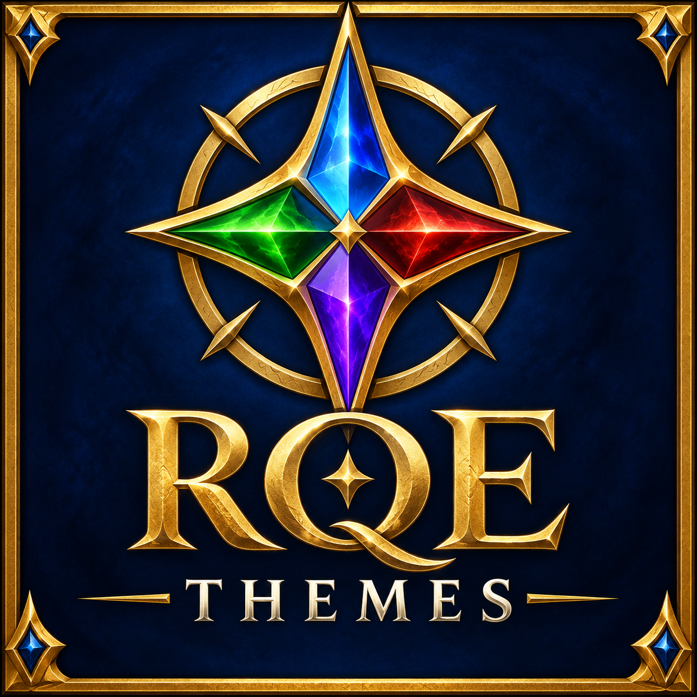
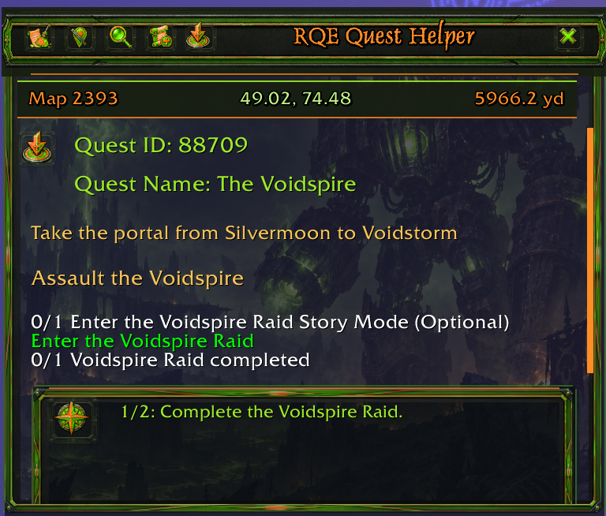
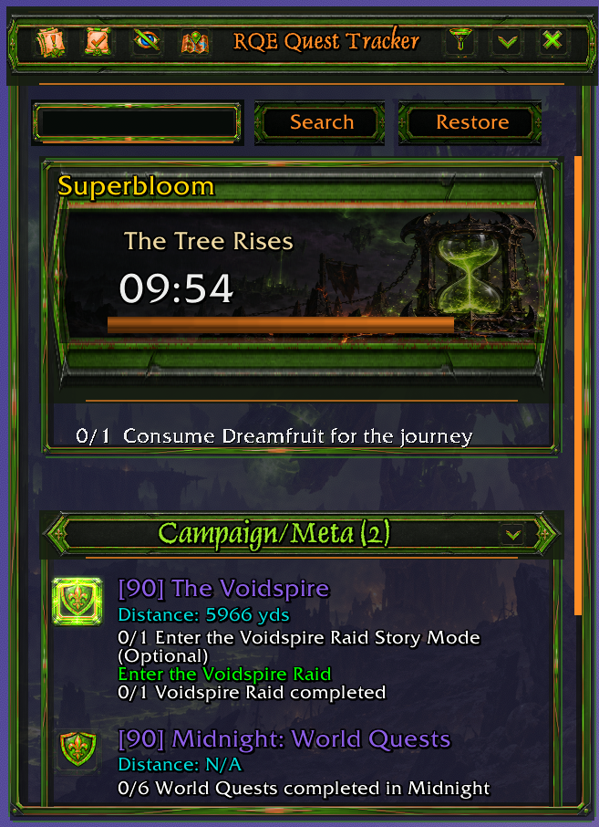

# RQE Themes

**More ways to make your questing interface your own.**

RQE Themes is a companion addon for [RQE – Rhodan's Quest Explorer](https://github.com/rhodan412/RQE). It adds optional appearances for RQE's Quest Helper, Quest Tracker, and Magic Button. The themes, artwork, and defaults are supplied by this companion addon; RQE keeps the player's choices in its existing profiles.

[Get the main RQE addon on CurseForge](https://www.curseforge.com/wow/addons/rqe-rhodans-quest-explorer) · [RQE source and player guide](https://github.com/rhodan412/RQE)

## Install and select a theme

1. Install and enable **RQE – Rhodan's Quest Explorer** and **RQE Themes** on WoW Retail, TBC Anniversary, Classic Season of Discovery, or Classic Forever. RQE Themes requires RQE **12.1.0.15 or newer**, which provides companion theme registration; the same package works on every client RQE supports.
2. Open RQE's configuration window and select the **Themes** tab.
3. Choose a look from the Tracker theme menu. Select a background picture, card styles, and opacity values to suit your layout.

RQE remains fully usable without this companion addon. RQE's existing profiles save your theme choices and adjustments; RQE Themes does not create a separate SavedVariables file or profile system.

## Available companion themes

| Theme | Appearance |
| --- | --- |
| **Burning Legion** | Fel-lit iron, molten bronze, and infernal green. |
| **Titan Archive** | Engraved stone, bronze, and luminous blue mapwork. |
| **Emerald Dream** | Living wood, emerald leaves, and quiet gold. |
| **Voidbound** | Obsidian facets, indigo shadows, and violet starlight. |
| **Pandaren Scroll** | Ink-wash mountains, carved jade, and warm parchment. |
| **Goblin Workshop** | Riveted steel, copper machinery, and amber light. |

All six include matching frames, headers, button states, semantic action icons, Helper and Tracker previews, and artwork for timed scenarios, dungeons, Delves, and Torghast. The five new themes each have three selectable background pictures and one theme-specific card style for each activity type. RQE's existing card styles remain available in the selector.

## Burning Legion artwork

- Matching frame and header borders, icon buttons, Magic Button textures, and themed icons.
- Three background pictures: **Sargeras**, **Fel Reaver**, and **Legion Warships**. Fel Reaver is the theme's default picture.
- Theme-specific card pictures for timed scenarios, Heroic, Normal, and Follower dungeons, Delves, and Torghast. These choices appear while Burning Legion is selected. The initial defaults are Fel Hourglass, Legion Standard, Soul Engine, Warglaive Rally, Azure Archive, and Runebound Chains, respectively.
- Individual opacity controls for background pictures, tooltip pictures, icon button borders, frame borders, and each scenario card picture. Player changes are saved in the selected RQE profile.

## In-game previews

| Quest Helper | Quest Tracker |
| :---: | :---: |
|  |  |

## Help and development

For RQE controls and questing features, see the [main addon's README and wiki](https://github.com/rhodan412/RQE). Report a problem with this companion addon in [RQE Themes issues](https://github.com/rhodan412/RQE_Themes/issues); report a core RQE problem in [RQE issues](https://github.com/rhodan412/RQE/issues).

New themes can be added here without a new RQE release when they use the existing theme registration interface. Theme definitions, defaults, and runtime artwork live in RQE Themes. The new looks use RQE's existing named font colors; they do not add a dependency on changes to RQE's color picker. See [AGENTS.md](AGENTS.md) for the artwork dimensions and integration checklist.
